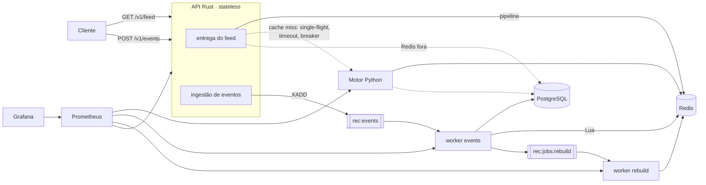

# Sistema de recomendação de conteúdo — Rust, Python, Redis e PostgreSQL

Implementação de referência, compacta e executável, de um sistema de recomendação
de feed no estilo de redes sociais: geração de candidatos por várias fontes,
ranking híbrido com sinais normalizados, diversidade, cold start, feeds
pré-calculados em cache, processamento assíncrono de interações, observabilidade
e testes de carga.

> Não é uma reprodução da infraestrutura nem dos algoritmos proprietários de
> Instagram, TikTok ou YouTube. É uma arquitetura pequena que demonstra os
> mesmos princípios — e que foi medida, não estimada (ver [Limitações](#23-limitações-conhecidas)).

## Sumário

1. [Visão geral](#1-visão-geral) · 2. [Objetivos e limitações](#2-objetivos-e-limitações-do-projeto) ·
3. [Diagrama](#3-diagrama-da-arquitetura) · 4. [Fluxo](#4-fluxo-completo-de-recomendação) ·
5. [Algoritmo](#5-explicação-do-algoritmo) · 6. [Versões](#6-tecnologias-e-versões) ·
7. [Pré-requisitos](#7-pré-requisitos) · 8. [Docker](#8-instalação-do-docker) ·
9. [Variáveis de ambiente](#9-configuração-das-variáveis-de-ambiente) · 10. [Subir](#10-como-iniciar-todos-os-serviços) ·
11. [Saúde](#11-como-verificar-a-saúde-dos-serviços) · 12. [Migrations](#12-como-executar-migrations) ·
13. [Seed](#13-como-gerar-dados-de-demonstração) · 14. [Usuários e conteúdos](#14-como-criar-usuários-e-conteúdos) ·
15. [Interações](#15-como-registrar-interações) · 16. [Recomendações](#16-como-consultar-recomendações) ·
17. [Eventos processados](#17-como-acompanhar-os-eventos-processados) · 18. [Prometheus e Grafana](#18-como-acessar-prometheus-e-grafana) ·
19. [Testes](#19-como-executar-testes-unitários-e-de-integração) · 20. [Carga](#20-como-executar-testes-de-carga) ·
21. [Escalar](#21-como-escalar-os-serviços) · 22. [Erros comuns](#22-como-solucionar-erros-comuns) ·
23. [Limitações](#23-limitações-conhecidas) · 24. [Roadmap](#24-roadmap-de-evolução)

Documentos complementares: [docs/ARCHITECTURE.md](docs/ARCHITECTURE.md) (decisões
e trade-offs), [docs/ALGORITHM.md](docs/ALGORITHM.md) (features, fórmula, filtros,
diversidade, cold start), [contracts/redis-keys.md](contracts/redis-keys.md)
(chaves e streams), [contracts/schemas/](contracts/schemas) (contratos JSON Rust ↔ Python).

---

## 1. Visão geral

| Serviço | Tecnologia | Papel |
|---|---|---|
| `api` | Rust · Actix Web | entrega o feed pré-calculado (2 round-trips ao Redis), filtra, pagina, recebe eventos, aplica fallback, autentica, limita taxa |
| `engine` | Python · FastAPI | gera o feed sob demanda num cache miss (interface interna) |
| `worker` | Python | consome eventos (idempotente), atualiza perfis/estatísticas/trending, marca feeds desatualizados, manutenção periódica |
| `worker-rebuild` | Python | regenera feeds em background |
| `redis` | Redis 7 | feeds, perfis, catálogo, contadores, streams de eventos e jobs |
| `postgres` | PostgreSQL 16 | fonte de verdade (usuários, autores, conteúdos, tags, interações, bloqueios) |
| `prometheus`, `grafana` | — | métricas e dashboard provisionado |

## 2. Objetivos e limitações do projeto

**Objetivos atendidos:** baixa latência com feed pré-calculado; separação entre
recuperação de candidatos, ranking e entrega; personalização por usuário;
ranking com 8 sinais normalizados; diversidade; cold start; atualização
incremental por eventos assíncronos; idempotência; degradação controlada;
escalabilidade horizontal sem estado local; métricas e logs estruturados;
testes em todas as camadas; carga medida.

**Limitações principais:** pesos ajustados à mão (sem aprendizado), similaridade
por tags (sem embeddings), autenticação de demonstração (HMAC; produção pede
OIDC/JWT), Redis em instância única. A lista completa está na
[seção 23](#23-limitações-conhecidas).

## 3. Diagrama da arquitetura



## 4. Fluxo completo de recomendação

1. O cliente pede `GET /v1/feed/{user_id}` com um token.
2. A API valida token, `limit` e `cursor`.
3. Em **um** round-trip lê os metadados do feed, os autores bloqueados e a primeira faixa do feed.
4. Em **outro** round-trip lê "já visto", score/motivo e metadados dos itens; filtra e pagina.
5. **Cache miss**: se ninguém está gerando aquele feed (lock), chama o motor com
   timeout de 800 ms; caso contrário — ou se o motor falhar, estiver saturado ou
   com o breaker aberto — responde na hora com **trending** e enfileira a geração.
   Sem trending (Redis recém-reiniciado), usa conteúdos recentes do PostgreSQL.
6. O motor gera candidatos, calcula features, ranqueia, aplica diversidade e grava
   o feed (300 itens) de forma atômica e versionada, com TTL de 1 h ± 10%.
7. A resposta sai sem esperar operações secundárias: a impressão é publicada e,
   se o feed estiver desatualizado, a regeneração é enfileirada em background.
8. Interações (`POST /v1/events`) entram no stream e recebem 202.
9. O worker grava no PostgreSQL, atualiza perfil/estatísticas/trending (Lua,
   idempotente), marca o feed como desatualizado e enfileira **uma** regeneração.
10. O worker de regeneração produz o feed novo; enquanto isso a API serve o
    anterior (`source: cache_stale`).

Trade-offs (pré-computação × tempo real, Streams × broker, etc.):
[docs/ARCHITECTURE.md](docs/ARCHITECTURE.md#decisões-técnicas).

## 5. Explicação do algoritmo

```
score = 0.30·interest + 0.20·author + 0.15·engagement + 0.10·popularity
      + 0.15·recency + 0.10·similarity + 0.06·exploration − 0.25·exposure
```

- **Candidatos**: autores com afinidade, categorias de interesse, itens similares
  aos consumidos recentemente, trending, exploração (autores desconhecidos) — com
  limite por fonte e teto de 800.
- **Filtros obrigatórios**: removidos, autores bloqueados, já vistos.
- **Features em [0,1]**: afinidade por categoria/tag e por autor (perfil com
  decaimento exponencial, meia-vida 14 d), engajamento com suavização bayesiana,
  popularidade em escala log, recência (meia-vida 48 h), similaridade de tags,
  exploração determinística, penalidade de exposição repetida.
- **Diversidade**: espaçamento por autor, limite por categoria em janela, cota por
  autor, slot de descoberta a cada 8 posições.
- **Cold start**: interesses declarados + trending + exploração, com pesos próprios.

Detalhes e justificativas: [docs/ALGORITHM.md](docs/ALGORITHM.md).

## 6. Tecnologias e versões

Versões fixadas em `Cargo.lock` e `uv.lock`. "Testado" = versão com que os testes
e medições deste repositório foram executados.

| Componente | Versão fixada | Mínimo | Observação |
|---|---|---|---|
| Rust (toolchain) | imagem `rust:1.97-slim-bookworm` | 1.94 (`rust-version`, exigido pelo sqlx 0.9) | testado com 1.97.0 |
| actix-web / redis / sqlx / reqwest / tokio | 4.15.0 / 1.7.1 / 0.9.0 / 0.13.5 / 1.53.2 | — | `Cargo.lock` |
| Python | imagem `python:3.13-slim-bookworm` | 3.13 | testado com 3.13.16 |
| FastAPI / uvicorn / redis-py / psycopg | 0.143.0 / 0.54.0 (`[standard]`) / 6.4.0 (+hiredis) / 3.3.6 | — | `uv.lock` (uv 0.11.32) |
| Redis | `redis:7.4.2-bookworm` | 7.0 (Streams, `XINFO` com `lag`, `ZMSCORE`) | testado com 7.0.15 |
| PostgreSQL | `postgres:16.15-bookworm` | 16 | testado com 16.15 |
| Prometheus | `prom/prometheus:v3.5.0` | — | configuração validada com promtool 3.5.0 |
| Grafana | `grafana/grafana:11.6.0` | — | dashboard provisionado |
| k6 | `grafana/k6:1.3.0` | — | usado nos testes de carga |

Nenhuma imagem usa `latest`. Para imutabilidade total em produção, troque as tags
por digests (`imagem@sha256:...`).

## 7. Pré-requisitos

- Docker Engine 24+ com Docker Compose v2 (`docker compose version`).
- 4 GB de RAM livres e ~3 GB de disco para imagens.
- `make`, `curl`, `jq` e `python3` (para gerar tokens e rodar o e2e).
- Opcional, para testes locais: [uv](https://docs.astral.sh/uv/) e Rust ≥ 1.94; k6.

## 8. Instalação do Docker

- **Linux**: siga https://docs.docker.com/engine/install/ para a sua distribuição e
  instale o plugin Compose (`docker-compose-plugin`). Adicione seu usuário ao grupo
  `docker` (`sudo usermod -aG docker $USER`) e abra uma nova sessão.
- **macOS / Windows**: instale o Docker Desktop (https://docs.docker.com/desktop/);
  no Windows, use o backend WSL 2 e rode os comandos dentro do WSL.

Confirme: `docker run --rm hello-world && docker compose version`.

## 9. Configuração das variáveis de ambiente

```bash
cp .env.example .env
# gere segredos e substitua os valores "troque-..." no .env:
python3 -c "import secrets; print(secrets.token_urlsafe(32))"
```

| Variável | Uso |
|---|---|
| `POSTGRES_PASSWORD`, `APP_DB_PASSWORD` | dono do banco (migrations) e role de aplicação `reco_app` (privilégio mínimo) |
| `REDIS_PASSWORD` | senha do Redis (use valores URL-safe) |
| `AUTH_MODE` | `hmac` (padrão) ou `disabled` (só desenvolvimento local) |
| `AUTH_SECRET` | segredo HMAC dos tokens (≥ 32 caracteres) |
| `INTERNAL_TOKEN` | token entre API e motor |
| `GRAFANA_ADMIN_PASSWORD` | senha do Grafana |
| `RANKING_WEIGHTS` | JSON parcial com pesos do ranking (ver [docs/ALGORITHM.md §9](docs/ALGORITHM.md#9-como-alterar-os-pesos-e-verificar-o-efeito)) |
| `ENGINE_TIMEOUT_MS`, `ENGINE_MAX_CONCURRENCY` | timeout e concorrência das chamadas da API ao motor |
| `FEED_SIZE`, `FEED_TTL_SECONDS`, `FEED_SOFT_TTL_SECONDS` | tamanho e validade do feed pré-calculado |
| `REBUILD_DEDUP_SECONDS` | janela de segurança da deduplicação de jobs |
| `SEED_USERS`, `SEED_AUTHORS`, `SEED_CONTENTS` | volume do seed |

O `.env` não é versionado (`.gitignore`). Nenhum segredo real está no repositório.

## 10. Como iniciar todos os serviços

```bash
make up          # = docker compose up -d --build + espera /ready
```

O Compose sobe PostgreSQL e Redis, roda o serviço `migrate` (one-shot) e só então
inicia `engine`, `worker`, `worker-rebuild` e `api`. Portas publicadas apenas em
`127.0.0.1`: API `8080`, Prometheus `9090`, Grafana `3000`. Redis e PostgreSQL
ficam só na rede interna `backend` (`internal: true`).

Depois, gere os dados de demonstração (seção 13): `make seed`.

<details>
<summary>Sem Docker (Redis e PostgreSQL locais)</summary>

Foi assim que as medições deste repositório foram feitas.

```bash
createdb reco && psql -d reco -c "CREATE ROLE reco_app LOGIN PASSWORD 'app_dev_pw'"
cd services/recommendation-engine-python && uv sync
DATABASE_URL=postgresql://postgres@127.0.0.1:5432/reco uv run python -m app.migrate
DATABASE_URL=postgresql://postgres@127.0.0.1:5432/reco uv run python -m app.seed --reset
cd ../recommendation-api-rust && cargo build --release && cd ../..
ENGINE_WORKERS=2 ./scripts/dev-native.sh start      # motor, 2 workers e API
AUTH_SECRET=local-demo-secret-local-demo-secret-0123 python3 scripts/make_token.py user 1
./scripts/dev-native.sh stop
```
</details>

## 11. Como verificar a saúde dos serviços

```bash
make ps                                  # estado/health de cada container
curl -s localhost:8080/health            # processo vivo
curl -s localhost:8080/ready | jq        # dependências
```

Resposta real de `/ready`:

```json
{"checks":{"engine":"ok","engine_breaker":"closed","postgres":"ok","redis":"ok"},"status":"ok"}
```

`status` é `ok`, `degraded` (Redis ok, mas PostgreSQL/motor fora — a API continua
servindo) ou `unavailable` (Redis fora → HTTP 503).

## 12. Como executar migrations

As migrations (`database/migrations/NNNN_*.sql`) rodam automaticamente no `make up`.
Para aplicar manualmente (idempotente, com advisory lock):

```bash
make migrate     # docker compose run --rm migrate
```

Nova migration: crie `database/migrations/0002_descricao.sql`; ela é aplicada uma
vez e registrada em `schema_migrations`.

## 13. Como gerar dados de demonstração

```bash
make seed                                   # 2.000 usuários, 300 autores, 20.000 conteúdos
make seed ARGS="--users 500 --contents 5000 --seed 7"
```

O seed é reproduzível (`--seed`, `--reference-time`), não usa APIs externas, grava
no PostgreSQL via `COPY`, limpa as chaves `rec:*` e reconstrói o catálogo no Redis
— o mesmo caminho usado na recuperação após perda do Redis. Saída real:

```json
{"postgres": {"categories": 12, "tags": 80, "users": 2000, "declared": 2093, "authors": 300, "blocks": 43, "contents": 20000, "content_tags": 48160, "interactions": 103447}, "postgres_seconds": 7.18, "redis_catalog": {"contents": 20000, "stats": 14447, "trend_rows": 8713, "elapsed_ms": 2829}}
```

Usuários de demonstração com ID fixo:

| ID | Handle | Perfil |
|---|---|---|
| 1 | `ana_games` | games e tecnologia, histórico rico |
| 2 | `bruno_chef` | culinária e viagem, histórico rico |
| 3 | `carla_nova` | nova; declarou interesse em música |
| 4 | `davi_zero` | nova; nada declarado (cold start puro) |

Tokens de demonstração (válidos por 24 h, assinados com o `AUTH_SECRET` do `.env`):

```bash
export U1="Authorization: Bearer $(make -s token ID=1)"
export U2="Authorization: Bearer $(make -s token ID=2)"
export ADMIN="Authorization: Bearer $(make -s token ADMIN=1)"
```

## 14. Como criar usuários e conteúdos

```bash
curl -s -X POST localhost:8080/v1/users -H "$ADMIN" -H 'content-type: application/json' \
  -d '{"handle":"eva_demo","declared_categories":["ciencia","pets"]}'
# {"declared_categories":["ciencia","pets"],"handle":"eva_demo","user_id":2001}

curl -s -X POST localhost:8080/v1/content -H "$ADMIN" -H 'content-type: application/json' \
  -d '{"author_id":7,"category":"ciencia","title":"Eclipse explicado em 5 minutos","tags":["astronomia","tutorial"]}'
# {"content_id":20001,"author_id":7,"category":"ciencia","tags":["astronomia","tutorial"],
#  "title":"Eclipse explicado em 5 minutos","status":"active","published_at":"2026-10-10T03:11:54.880Z"}

curl -s localhost:8080/v1/content/20001 -H "$U1" | jq     # inclui estatísticas
curl -s -X DELETE localhost:8080/v1/content/20001 -H "$ADMIN" -o /dev/null -w '%{http_code}\n'   # 204
```

Categorias e tags válidas estão em `database/seeds/taxonomy.json`. O conteúdo
novo é indexado pelo worker (evento `content_published`) em poucos milissegundos;
removido, some do feed imediatamente (o filtro de entrega lê o status).

## 15. Como registrar interações

Tipos aceitos: `content_viewed`, `content_liked`, `content_saved`,
`content_shared`, `content_commented` (até 100 por requisição; `occurred_at`
opcional, entre −7 dias e +5 min). Impressões (`feed_impression`) são geradas pela
própria API ao entregar o feed — impressão é exposição, não interesse.

```bash
curl -s -X POST localhost:8080/v1/events -H "$U1" -H 'content-type: application/json' -d '{
  "events": [
    {"event_id":"3f2b7c1a-9d4e-4f6a-8b2c-1d3e5f7a9b0c","type":"content_liked","user_id":1,"content_id":42},
    {"type":"content_viewed","user_id":1,"content_id":43}
  ]}'
# HTTP 202 {"accepted":2,"event_ids":["3f2b7c1a-...","<gerado>"]}
```

Enviar `event_id` torna o reenvio seguro: o mesmo evento nunca conta duas vezes.

## 16. Como consultar recomendações

```bash
curl -s -i "localhost:8080/v1/feed/1?limit=3" -H "$U1"
```

```http
HTTP/1.1 200 OK
x-feed-source: cache
x-request-id: 50278713-8cdd-4a3a-a7c4-2e6ac68e9195
```
```json
{"user_id":1,"source":"cache","feed_version":1791601774608,"stale":false,"next_cursor":"1791601774608:3",
 "items":[
  {"content_id":14968,"position":0,"author_id":121,"category":"games","tags":["rpg"],"title":"Experimento surpreendente de games #14968","published_at":"2026-10-09T18:24:07.000Z","score":0.781621,"reason":"similar"},
  {"content_id":2033,"position":1,"author_id":93,"category":"tecnologia","tags":["curiosidades","open-source"],"title":"Comparativo secreto de tecnologia #2033","published_at":"2026-10-09T23:04:00.000Z","score":0.640976,"reason":"interest"},
  {"content_id":11160,"position":2,"author_id":112,"category":"games","tags":["fps","indie"],"title":"Comparativo essencial de games #11160","published_at":"2026-10-09T16:24:00.000Z","score":0.631985,"reason":"interest"}]}
```

- Próxima página: `?limit=3&cursor=1791601774608:3`.
- `source`: `cache`, `cache_stale` (servido e regenerando em background), `built`
  (gerado agora), `fallback_trending`, `fallback_recent`.
- `reason`: sinal dominante (`author`, `interest`, `similar`, `trending`, `explore`, `recent`).
- `score` é o score individual; a ordem final inclui a diversidade (por isso não é monotônico).

Outros endpoints:

```bash
curl -s localhost:8080/v1/users/1/interests -H "$U1" | jq     # perfil agregado (pesos relativos)
curl -s -X POST localhost:8080/v1/recommendations/rebuild/1 -H "$U1"   # {"status":"queued","user_id":1}
```

Erros padronizados (`{"error":{"code","message"}}`): 400 entrada inválida, 401 sem
token, 403 token de outro usuário, 404, 413/400 corpo acima de 64 KiB, 422 regra de
negócio, 429 limite de taxa (com `Retry-After`), 503 dependência indisponível.

| Método | Rota | Quem |
|---|---|---|
| GET | `/health`, `/ready`, `/metrics` | público (rede local) |
| GET | `/v1/feed/{user_id}?limit&cursor` | o próprio usuário ou admin |
| POST | `/v1/events` | o próprio usuário |
| POST | `/v1/users` | admin |
| POST / GET / DELETE | `/v1/content`, `/v1/content/{id}` | admin / autenticado / admin |
| POST | `/v1/recommendations/rebuild/{user_id}` | o próprio usuário ou admin |
| GET | `/v1/users/{user_id}/interests` | o próprio usuário ou admin |

> O `user_id` da URL nunca autoriza sozinho: o token precisa ser daquele usuário.
> Em produção, substitua o esquema HMAC de demonstração por OIDC/JWT.

### Fluxo completo automatizado

```bash
make e2e
```

Executa os critérios de aceitação: feeds diferentes por usuário, leitura do
cache, paginação, interações mudando o perfil e o feed, idempotência, indexação
de conteúdo novo, cold start, perda total do Redis com reconstrução e métricas.
Saída real (resumida):

```
== 2. Feeds personalizados para usuários diferentes
  ana_games  (built): games=10 tecnologia=10
  bruno_chef (built): culinaria=10 viagem=10
  ✔ feeds diferentes (itens em comum no top 20: 0)
== 4. Interações mudam o perfil e o feed (processamento assíncrono)
  ✔ perfil atualizado: ["tecnologia:1.0","culinaria:0.978","games:0.811"]
  ✔ feed regenerado em background
  ✔ fatia de culinária no top 20: 0 → 0.55
== 5. Idempotência: reenviar o mesmo event_id não conta duas vezes
  ✔ 3 envios do mesmo evento → likes 11 → 12
== 8. Perda do Redis: degradação controlada e reconstrução
  logo após a perda: source=fallback_recent
  ✔ feed personalizado reconstruído a partir do PostgreSQL
17 verificações OK
```

## 17. Como acompanhar os eventos processados

```bash
# backlog do consumer group (lag = ainda não entregues; pending = entregues sem ACK)
docker compose exec redis sh -c 'redis-cli -a "$REDIS_PASSWORD" --no-auth-warning XINFO GROUPS rec:events'
docker compose exec redis sh -c 'redis-cli -a "$REDIS_PASSWORD" --no-auth-warning XINFO GROUPS rec:jobs:rebuild'
# mensagens rejeitadas (motivo + payload)
docker compose exec redis sh -c 'redis-cli -a "$REDIS_PASSWORD" --no-auth-warning XRANGE rec:events:dlq - + COUNT 10'
# contadores do worker
docker compose exec worker python -c "import urllib.request;print(urllib.request.urlopen('http://127.0.0.1:9100/metrics').read().decode())" | grep reco_worker_
make logs
```

No Grafana, os painéis "Eventos ingeridos/processados", "Atraso de processamento"
e "Backlog dos streams" mostram o mesmo em tempo real.

## 18. Como acessar Prometheus e Grafana

- Prometheus: http://localhost:9090 (alvos em *Status → Targets*; réplicas descobertas por DNS).
- Grafana: http://localhost:3000 (usuário/senha do `.env`), pasta **Recomendação →
  Sistema de recomendação — visão geral** (provisionado automaticamente).

Como ler o dashboard:

| Painel | O que indica |
|---|---|
| Latência do feed p50/p95/p99 | experiência do cliente; p99 subindo com "Origem" mostrando `built` = muitos misses |
| Origem das respostas | `cache` deve dominar; `fallback_*` = degradação; `shed` = sobrecarga recusada |
| Taxa de acerto do cache | hit/(hit+miss) das consultas ao feed pré-calculado |
| Tempo de geração por etapa | onde o motor gasta tempo (candidatos, features, ranking, escrita) |
| Circuit breaker | 1 = motor fora; misses vão direto ao trending |
| Backlog dos streams | lag crescente = workers insuficientes (`make scale WORKERS=N`) |
| Atraso de processamento | tempo entre o evento e seu efeito no perfil |
| Diversidade por página | autores distintos por página e fatia do autor dominante |
| Erros de dependências e DLQ | falhas de Redis/PostgreSQL e mensagens rejeitadas |

Métricas não usam IDs de usuário/conteúdo como label.

## 19. Como executar testes unitários e de integração

```bash
make test-deps     # Redis e PostgreSQL descartáveis em 127.0.0.1:56379/55432
make test          # Python (pytest) + Rust (cargo test)
make lint          # rustfmt + clippy -D warnings
make test-deps-down
```

Resultado da última execução: **68 testes, todos passando** — Python 50
(unitários de features, ranking, diversidade, pipeline e perfil; integração com
Redis/PostgreSQL reais: idempotência, DLQ, impressão ≠ interesse, perfil
incremental = reconstrução completa, escrita atômica, recuperação após perda do
Redis, cold start, worker e pendentes; API do motor; contrato) e Rust 18
(unitários de auth, cursor, filtros e breaker; integração com Redis/PostgreSQL:
autorização, paginação com filtros, stale-while-revalidate, fallback com motor
fora e breaker, fallback no PostgreSQL, validação de eventos, deduplicação e
limites; contrato).

**Contrato Rust ↔ Python**: `contracts/examples/*.json` são validados contra os
JSON Schemas e o modelo Pydantic no Python e desserializados (com
`deny_unknown_fields`) nos structs Rust — uma divergência de campo quebra os
dois lados.

## 20. Como executar testes de carga

```bash
make seed && make load          # bateria completa via container k6
# ou, com k6 local:
K6=k6 ./scripts/load-test.sh
# cenário avulso:
k6 run -e SCENARIO=warm -e RATE=1000 -e DURATION=60s -e AUTH_SECRET=... tests/load/scenarios.js
```

Cenários: `warm` (cache aquecido), `hot_user` (pico no mesmo usuário), `cold`
(cache vazio), `many_users`, `events` (lotes de 20), `ramp` (concorrência
crescente) e `engine_down` (cache vazio com o motor parado). Resultados em
`tests/load/results/` (resumo em `summary.txt`).

**Metas iniciais** (thresholds do k6, para um ambiente modesto — metas de teste,
não garantias): cache quente p95 < 25 ms e p99 < 50 ms; eventos p95 < 25 ms;
erros < 1%.

**Medido** em 10/10/2026 numa VM de 2 vCPU com **tudo no mesmo host** (API, motor,
workers, Redis, PostgreSQL e o próprio k6), sem Docker:

| Cenário | Taxa | p50 | p95 | p99 | Erros |
|---|---|---|---|---|---|
| Cache quente | 1.000 req/s | 1,98 ms | 7,92 ms | 15,64 ms | 0% |
| Mesmo usuário | 1.000 req/s | 1,77 ms | 6,61 ms | 13,43 ms | 0% |
| Usuários aleatórios | 300 req/s | 2,63 ms | 48,71 ms | 240,51 ms | 0% |
| Eventos (20/req) | 4.000 eventos/s | 4,47 ms | 15,47 ms | 21,98 ms | 0% |
| Rampa até 2.000 req/s | teto ~1.230 req/s | 29,91 ms | 151,37 ms | 222,63 ms | 0% |
| Cache vazio | 400 usuários | 17,46 ms | 28,65 ms | 200,19 ms | 0% |
| Cache vazio, motor parado | 200 usuários | 19,48 ms | 31,41 ms | 274,40 ms | 0% |

Arquivos brutos: [docs/benchmarks/2026-10-10-nativo-2vcpu/](docs/benchmarks/2026-10-10-nativo-2vcpu).
A bateria **não** foi executada via Docker Compose neste ambiente (ver seção 23).

## 21. Como escalar os serviços

```bash
make scale WORKERS=3 REBUILDERS=2          # consumidores extras no mesmo consumer group
ENGINE_WORKERS=4 docker compose up -d engine   # processos uvicorn por container do motor
```

- `worker`/`worker-rebuild`: as mensagens são divididas entre as réplicas; a
  manutenção periódica roda em uma por vez (lock no Redis).
- `api`: é stateless. Como o Compose publica uma porta fixa, para várias réplicas
  remova `ports` do serviço e coloque um balanceador (nginx/Traefik) na frente.
- `engine`: prefira aumentar `ENGINE_WORKERS`. Réplicas (`make scale ENGINES=2`)
  funcionam, mas a API reaproveita conexões HTTP e o DNS do Docker não balanceia
  por requisição — a distribuição entre réplicas fica desigual sem um balanceador.
- O Prometheus descobre réplicas automaticamente (DNS do Docker).
- Ajuste junto: `ENGINE_MAX_CONCURRENCY` (por réplica da API) ≈ capacidade total
  do motor ÷ réplicas da API; `DB_MAX_CONNECTIONS` × réplicas < `max_connections` do PostgreSQL.

## 22. Como solucionar erros comuns

| Sintoma | Causa provável | Solução |
|---|---|---|
| `defina REDIS_PASSWORD no .env` ao subir | `.env` ausente | `make env` e edite os segredos |
| API sai com `AUTH_SECRET precisa de pelo menos 32 caracteres` | segredo curto | aumente `AUTH_SECRET` |
| `401 unauthorized` | token ausente, expirado ou de outro `AUTH_SECRET` | `make -s token ID=1` com o mesmo `.env` da API |
| `403 forbidden` | token de outro usuário ou não-admin | use o token do dono ou `make -s token ADMIN=1` |
| Feed sempre `fallback_trending` | motor fora/breaker aberto ou seed não aplicado | `curl localhost:8080/ready`, `make logs`, `make seed` |
| `fallback_recent` logo após reiniciar o Redis | catálogo sendo reconstruído | normal; em ≤ 30 s volta ao personalizado |
| Interações não mudam o feed | worker parado ou atrasado | `make ps`, painel "Backlog dos streams", `make scale WORKERS=2` |
| Eventos na DLQ com `unknown_user`/`unknown_content` | IDs inexistentes | confira os IDs; a DLQ guarda o payload |
| `migrate` falha com permissão | volume do PostgreSQL criado com outra senha | `make clean && make up` (apaga os dados) |
| 503 com `Retry-After` sob carga | load shedding (proteção do PostgreSQL) | escale a API/Redis ou reduza a taxa |
| `permission denied` ao gravar resultados do k6 no container | usuário do container ≠ dono da pasta | `chmod a+w tests/load` ou use k6 local |

## 23. Limitações conhecidas

- **Verificação em Docker**: neste ambiente de desenvolvimento o Docker Hub estava
  inacessível e não havia daemon Docker; as imagens não foram construídas e o
  `docker compose up` não foi executado. Tudo foi executado nativamente (mesmos
  comandos dos containers); o Compose foi validado com `docker compose config`, o
  Prometheus com `promtool` e com execução real, e os passos do Dockerfile Python
  reproduzidos fora do Docker. O Grafana não foi executado. Detalhes em
  [docs/ARCHITECTURE.md](docs/ARCHITECTURE.md#o-que-não-foi-verificado).
- Ranking linear com pesos manuais; sem modelo treinado nem embeddings.
- Autenticação HMAC de demonstração, sem revogação.
- Redis em instância única; scripts Lua não são compatíveis com Redis Cluster sem ajustes.
- Até ~1 s de eventos pode se perder se o Redis cair antes de o worker persisti-los (AOF `everysec`).
- Impressões vivem só no Redis (TTL de 7 dias) e não são recuperadas após perda.
- Paginação recomeça se o feed for regenerado entre páginas.
- O teto medido (~1.230 req/s) é de uma VM de 2 vCPU compartilhada com o gerador de carga.
- A publicação de `content_published` acontece após o commit; se o Redis falhar
  nesse instante o conteúdo só entra no catálogo na próxima reconstrução (um
  outbox transacional resolveria).

## 24. Roadmap de evolução

1. Aprender os pesos (regressão logística / LambdaMART) com impressões e interações já registradas; testes A/B por coorte.
2. Embeddings de conteúdo e usuário com busca ANN (pgvector ou FAISS) como nova fonte de candidatos.
3. Outbox transacional para eventos de domínio e persistência de impressões em armazenamento colunar.
4. OIDC/JWT, revogação de tokens e rate limiting por plano.
5. Redis Cluster com hash tags por usuário; réplicas de leitura para a API.
6. Feature store com features temporais (janelas de 1 h/24 h/7 d) e monitoramento de drift.
7. Manifests Kubernetes/Helm opcionais com HPA guiado por latência e backlog.
