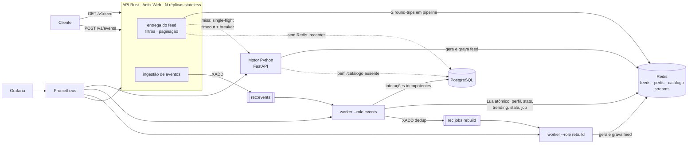

# Arquitetura e decisões técnicas

## Visão geral



| Componente | Responsabilidade | Estado |
|---|---|---|
| API Rust | autenticação, validação, entrega do feed pré-calculado, filtros na entrega, paginação, ingestão de eventos, fallback, rate limit, métricas | nenhum (stateless) |
| Motor Python (FastAPI) | gerar feed sob demanda num cache miss (interface interna) | nenhum |
| `worker --role events` | consumir `rec:events`, persistir interações, atualizar perfis/estatísticas/trending, marcar feeds stale; manutenção periódica (trending, reconstrução do catálogo) | nenhum (consumer group) |
| `worker --role rebuild` | regenerar feeds em background a partir de `rec:jobs:rebuild` | nenhum (consumer group) |
| Redis | dados derivados de baixa latência e filas | derivado, reconstruível |
| PostgreSQL | fonte de verdade: usuários, autores, conteúdos, tags, interações, bloqueios | persistente |

O mesmo pacote Python (`app/recommender`) é usado pelo motor HTTP e pelo worker
de regeneração: a lógica de ranking existe em um único lugar.

## Fluxo de leitura (feed)

1. API valida token e `user_id`, `limit` (1–50) e `cursor`.
2. **Round-trip 1** (pipeline): `HGETALL rec:feed:meta:{uid}`, `HGET` dos autores
   bloqueados e, de forma otimista, `ZREVRANGE` da primeira faixa do feed.
3. **Round-trip 2** (pipeline): `ZMSCORE rec:seen:{uid}` + `HMGET` de
   score/motivo + `HMGET` dos metadados de cada item.
4. Filtra (já visto, removido, autor bloqueado), monta a página, responde.
5. Fora do caminho da resposta: publica a impressão (`feed_impression`) e, se o
   feed estiver stale, enfileira a regeneração.

Se a página não fecha por causa dos filtros, lê mais faixas (até 4 rodadas).
Conteúdos ausentes do catálogo no Redis são buscados no PostgreSQL em **uma**
consulta `= ANY($1)` — nunca uma por item.

### Cache miss

```
sem rec:feed:meta  →  SET rec:lock:build:{uid} NX EX 15
   ├─ não obteve o lock (outra requisição já está gerando)  → trending agora
   ├─ breaker aberto / motor saturado (semáforo)            → trending agora + job
   └─ obteve → POST motor (timeout 800 ms)
         ├─ 200 → lê o feed recém-gravado (source: built)
         ├─ 404 → usuário não existe (404)
         └─ erro/timeout → breaker conta falha, job em background, trending agora
trending vazio (Redis recém-reiniciado) → conteúdos recentes do PostgreSQL
Redis indisponível → conteúdos recentes do PostgreSQL (concorrência limitada) ou 503
```

O cliente **nunca espera** por outra requisição que esteja gerando o mesmo feed:
recebe o fallback imediatamente. Isso troca qualidade da primeira página por
latência previsível e evita filas de requisições presas (cache stampede).

## Fluxo de escrita (eventos)

1. `POST /v1/events` valida (tipo permitido ao cliente, dono do `user_id`,
   `occurred_at` entre −7 dias e +5 min, até 100 eventos) e faz `XADD` em pipeline.
   Responde 202 sem tocar no PostgreSQL.
2. O worker lê lotes de até 200 mensagens do consumer group:
   - valida o envelope (Pydantic, mesmo contrato do JSON Schema);
   - confere usuários e conteúdos existentes em **uma** consulta por lote;
   - `INSERT ... SELECT FROM unnest(...) ON CONFLICT (event_id) DO NOTHING`;
   - aplica `apply_interaction.lua` em pipeline (idempotente por `rec:evt:{event_id}`);
   - `XACK`.
3. Inválidos, usuário/conteúdo inexistente → `rec:events:dlq` com o motivo.

### Idempotência ponta a ponta

- O cliente pode enviar `event_id`; reenvios com o mesmo ID são seguros.
- PostgreSQL: `event_id` é chave primária (`ON CONFLICT DO NOTHING`).
- Redis: o Lua começa com `SET rec:evt:{id} NX EX 7d`; se já existe, nada muda.
- Se o worker cair entre o INSERT e o XACK, a reentrega vira no-op nos dois lados.
- Verificado em `test_event_processing_is_idempotent` e no passo 5 do `scripts/e2e.sh`
  (3 envios do mesmo evento → +1 like).

### Mensagens pendentes e poison messages

- Ao iniciar (e após qualquer erro), o worker relê as próprias pendentes (`XREADGROUP ... 0`).
- A cada 30 s, `XPENDING` com idle ≥ 60 s: mensagens de consumers mortos são
  reivindicadas (`XCLAIM`); as entregues mais de 5 vezes vão para a DLQ.
- Erro de dependência (Redis/PostgreSQL fora) → nada é confirmado, backoff
  exponencial (até 10 s), reprocessa depois.
- Erro de dado/bug num lote → o lote é reprocessado mensagem a mensagem; só a
  culpada vai para a DLQ (`test_isolate_poison_keeps_good_events`).

## Decisões técnicas

### Pré-computação × ranking em tempo real

| | Pré-computar (escolhido como caminho principal) | Ranquear por requisição |
|---|---|---|
| Latência do feed | 2 round-trips ao Redis (p50 ~2 ms medido) | geração completa (~50 ms medido) |
| Custo | proporcional a usuários **ativos** × regenerações | proporcional a requisições |
| Frescor | defasagem de segundos após interação (SWR) | imediato |
| Falha do motor | feed continua sendo servido | sem feed |

Para compensar a defasagem, a API aplica na entrega o filtro "já visto" com o
estado atual, e o feed é regenerado em background a cada interação explícita
(coalescido) ou após 10 min (soft TTL). O ranking em tempo real só acontece no
cache miss, protegido por single-flight, semáforo, timeout e breaker.

### Redis Streams em vez de um broker dedicado

O volume esperado cabe no Redis, que já é dependência obrigatória; Streams dão
consumer groups, ack, reentrega e inspeção de pendentes. Kafka/RabbitMQ
acrescentariam um serviço sem ganho para este escopo. Trade-off: o stream é
limitado por `MAXLEN ~` e o Redis usa AOF a cada segundo — num crash do Redis
podem se perder até ~1 s de eventos ainda não persistidos no PostgreSQL. Para
durabilidade mais forte: `appendfsync always` (mais lento) ou um broker com
replicação.

### Scripts Lua para efeitos no Redis

Cada interação atualiza ~12 chaves (estatística, trending, perfil, visto,
recentes, meta do feed, job). Num script Lua isso é atômico e idempotente, e o
worker envia os scripts de um lote inteiro num único pipeline.

### Perfis com decaimento incremental

Ver docs/ALGORITHM.md §1. O perfil no Redis é derivado: some (TTL, eviction,
flush) e é reconstruído das interações persistidas na próxima geração. Para não
contar duas vezes um evento que já estava no snapshot da reconstrução, o Lua só
aplica o efeito no perfil se `ingested_at ≥ rebuilt_at − 2 s`. A margem de 2 s
cobre transações confirmadas fora de ordem; no pior caso um evento dentro da
margem é contado duas vezes (erro pequeno e transitório, preferível a perder
eventos).

### Escrita atômica e versionada do feed

O motor grava em chaves temporárias e faz `RENAME` dentro de `MULTI/EXEC`: um
leitor nunca vê um feed pela metade. `version` (ms) entra no cursor
(`<versão>:<offset>`); se o feed for regenerado entre duas páginas, a paginação
recomeça no feed novo em vez de pular ou repetir itens de forma arbitrária.

### TTL com jitter, stale-while-revalidate e deduplicação de jobs

- TTL do feed: 1 h ± 10% — evita expiração simultânea de milhares de feeds.
- Soft TTL de 10 min ou flag `stale`: serve o feed atual e agenda regeneração.
- `rec:job:pending:{uid}` (SET NX) garante no máximo **um job na fila por
  usuário**; o worker apaga a chave quando **começa** o job, então interações que
  chegam durante a geração enfileiram um novo job em vez de se perderem.
- Jobs obsoletos (feed gerado depois do pedido e não stale) são descartados sem
  recalcular; regeneração pedida pela API é sempre executada.

### Circuit breaker e limites de concorrência

Justificativa: no miss, a API chama o motor de forma síncrona. Sem proteção, um
motor lento prenderia requisições até o timeout e a fila cresceria (cascata).
- Semáforo de 4 chamadas simultâneas ao motor por réplica da API
  (`ENGINE_MAX_CONCURRENCY`): o excedente recebe fallback na hora. Medido: com
  limite alto (16), misses concorrentes saturavam o motor, estouravam o timeout e
  abriam o breaker; com 4, a latência do miss ficou previsível.
- Breaker: 5 falhas seguidas → aberto por 10 s → meio-aberto (uma tentativa).
- Fallback no PostgreSQL limitado a metade do pool (`db_fallback_slots`): sob
  sobrecarga, o fallback não vira uma segunda onda de carga no banco; o excedente
  recebe 503 com `Retry-After`. Isso foi introduzido após um teste de carga em que
  timeouts do Redis por CPU saturada desviavam tráfego para o PostgreSQL e
  esgotavam o pool.

### Workers separados por papel

A geração de feed é CPU-bound e, no mesmo processo Python, disputa o GIL com o
consumo de eventos. Medido no mesmo host: com os dois papéis num processo, o
consumo caiu para ~320 eventos/s e o backlog chegou a 80 mil mensagens durante a
carga; separados (`worker` e `worker-rebuild`), o backlog zerou logo após o pico
(atraso médio de 0,3 s). Isolado, um processo consome ~2.000–2.400 eventos/s.

### uvicorn com uvloop/httptools

Com `uvicorn` "puro" (h11 + asyncio), cada resposta do motor levava ~40 ms extras
(interação Nagle/delayed-ACK). Com `uvicorn[standard]`, `/health` caiu de 43 ms
para 1 ms e a chamada de geração de 100 ms para 50 ms (medido). Também usamos
`hiredis` para o parser do redis-py.

### Banco de dados

- Migrations SQL versionadas, aplicadas por um runner próprio com advisory lock
  (`app/migrate.py`), serviço `migrate` executado antes de tudo no Compose.
- Índices parciais (`WHERE status = 'active'`) para pools por categoria/autor/recência;
  `interactions (user_id, occurred_at DESC)` para reconstrução de perfil.
- Impressões **não** vão para o PostgreSQL (volume alto, valor baixo para recuperação).
- Privilégio mínimo: `reco_owner` aplica migrations; a aplicação usa `reco_app`
  (SELECT/INSERT nas tabelas necessárias e UPDATE apenas da coluna `status`).
- `statement_timeout` de 2 s na API e 5 s no motor; 120 s só na reconstrução em lote.

### Autenticação

O `user_id` do path nunca autoriza sozinho. Com `AUTH_MODE=hmac`, o token
`u.<id>.<exp>.<hmac>` identifica o usuário e precisa bater com o recurso
(`a.0.<exp>.<hmac>` = admin, para criar conteúdo/usuário). A verificação usa
comparação em tempo constante. **Em produção**, troque por tokens de um provedor
de identidade (OIDC/JWT com rotação de chaves); a interface (`Identity`) já
isola essa decisão. O motor interno exige `X-Internal-Token` e não é exposto.

### Observabilidade

- Métricas sem IDs nos labels: rota como padrão (`/v1/feed/{user_id}`), fonte,
  motivo, etapa. "Distribuição por autor" é medida como autores distintos por
  página e fatia do autor dominante, sem label de autor.
- Logs JSON com `request_id` (aceito do cliente se curto/ASCII, senão gerado),
  propagado da API para o motor. Não registramos tokens nem corpo de requisição.
- O motor com vários processos usa o modo multiprocesso do `prometheus_client`.

## Falhas e degradação

| Situação | Comportamento | Verificado em |
|---|---|---|
| Redis indisponível | API responde com conteúdos recentes do PostgreSQL (sem personalização, concorrência limitada) ou 503; ingestão de eventos responde 503; workers fazem backoff e reprocessam pendentes | `serve_feed` + teste `empty_redis_falls_back...` (Redis vazio) |
| Redis perde os dados | catálogo/pools/trending reconstruídos pela manutenção (≤ 30 s) ou na primeira geração; perfis reconstruídos por usuário; consumer groups recriados | `scripts/e2e.sh` passo 8, `test_recovery_after_redis_loss_reproduces_feed` |
| PostgreSQL indisponível | feeds em cache continuam servidos normalmente; misses de usuários sem perfil no Redis caem no trending; worker não confirma eventos (ficam pendentes até o banco voltar) | lógica + teste de pendentes |
| Motor Python indisponível | misses recebem trending imediatamente; breaker abre; jobs em background continuam (o worker gera feeds sem o motor HTTP) | `miss_with_engine_down...`, cenário de carga `engine_down` |
| Worker atrasado | feeds continuam servidos (stale); perfis atualizam com atraso; `reco_worker_stream_lag` e o painel de backlog mostram o atraso. Solução: `--scale worker=N` | carga `events`/`ramp` |
| Feed vazio | trending; se vazio, recentes do PostgreSQL | testes de fallback |
| Usuário novo | perfil inicial com interesses declarados; pesos de cold start | `test_cold_start_users`, e2e passo 7 |
| Pico de interações | API só faz XADD (O(1)); stream absorve; workers drenam em lote; regenerações coalescidas por usuário | carga `events` (4.000 eventos/s) |
| Mensagem reentregue | no-op (PostgreSQL + chave de idempotência no Lua) | `test_event_processing_is_idempotent` |
| Mensagem envenenada | DLQ após isolamento; demais mensagens seguem | `test_isolate_poison...`, `test_stale_pending...` |

## Escalabilidade

- **API**: stateless; `docker compose up --scale api=N` atrás de um balanceador
  (o Compose publica uma porta só; para N réplicas, coloque um proxy na frente ou
  use um orquestrador). Prometheus descobre réplicas por DNS.
- **Workers**: N consumidores no mesmo consumer group dividem as mensagens.
  `--scale worker=N --scale worker-rebuild=M`. A manutenção roda em uma réplica por
  vez (lock).
- **Motor**: `ENGINE_WORKERS` processos por container e/ou réplicas.
- **Redis**: o próximo gargalo provável. Caminhos: réplicas de leitura para a
  API, separar streams e cache em instâncias diferentes, e Redis Cluster (exige
  hash tags por usuário — ver contracts/redis-keys.md).
- **PostgreSQL**: só é tocado em lote (worker) e em reconstruções; particionar
  `interactions` por tempo quando crescer.

## Capacidade medida

Ambiente: VM com 2 vCPU (Intel Xeon 2,8 GHz) e 7,8 GiB de RAM, **todos os
processos no mesmo host** — API, motor (2 processos), 2 workers, Redis 7.0.15,
PostgreSQL 16.15, Prometheus e o próprio gerador de carga k6 1.3.0 — sem Docker
(o registro de imagens não estava acessível no ambiente de desenvolvimento).
Dados: seed padrão (2.000 usuários, 300 autores, 20.000 conteúdos, ~103 mil
interações). Resultados completos: `docs/benchmarks/2026-10-10-nativo-2vcpu/`.

| Cenário | Taxa | p50 | p95 | p99 | Erros |
|---|---|---|---|---|---|
| Feed, cache quente (1.000 usuários) | 1.000 req/s | 1,98 ms | 7,92 ms | 15,64 ms | 0% |
| Pico no mesmo usuário | 1.000 req/s | 1,77 ms | 6,61 ms | 13,43 ms | 0% |
| Usuários aleatórios (hit + miss) | 300 req/s | 2,63 ms | 48,71 ms | 240,51 ms | 0% |
| Eventos em lote (20/req) | 200 req/s (4.000 eventos/s) | 4,47 ms | 15,47 ms | 21,98 ms | 0% |
| Rampa até 2.000 req/s | máx. sustentado ~1.230 req/s | 29,91 ms | 151,37 ms | 222,63 ms | 0% |
| Cache vazio (400 usuários novos, 20 VUs) | — | 17,46 ms | 28,65 ms | 200,19 ms | 0% |
| Cache vazio com o motor parado | — | 19,48 ms | 31,41 ms | 274,40 ms | 0% |

Leituras: o teto de ~1.230 req/s é do host inteiro (o k6 disputa CPU com a
aplicação); no cache vazio a maioria das primeiras requisições recebe fallback
(trending) e o feed personalizado é gerado em background. Estes números são
medições deste ambiente, não garantias.

## O que não foi verificado

- `docker compose up` e o build das imagens não puderam ser executados aqui: o
  Docker Hub estava bloqueado e não havia daemon Docker. O Compose foi validado
  com `docker compose config`, a configuração do Prometheus com `promtool` 3.5.0
  e todas as consultas do dashboard contra um Prometheus real; os passos do
  Dockerfile Python foram reproduzidos fora do Docker. As tags de imagem
  (`rust:1.97-slim-bookworm`, `python:3.13-slim-bookworm`, `postgres:16.15-bookworm`,
  `redis:7.4.2-bookworm`, `prom/prometheus:v3.5.0`, `grafana/grafana:11.6.0`,
  `grafana/k6:1.3.0`) não foram puxadas neste ambiente.
- O Grafana não foi executado; o dashboard é JSON provisionado cujas consultas
  foram testadas no Prometheus.
- Os testes rodaram com Redis 7.0.15; a imagem do Compose usa 7.4.2 (os comandos
  usados existem desde o 7.0).
